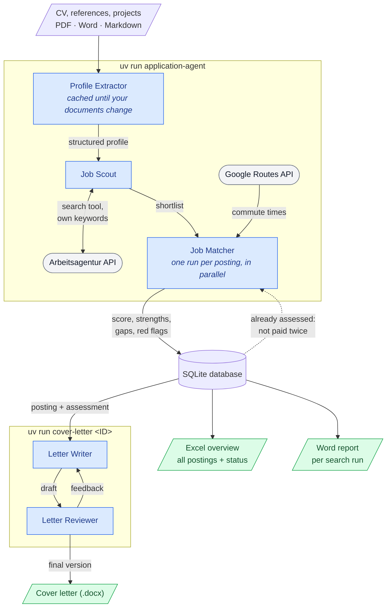

# Application Agent

[](https://github.com/Meilocora/Application_Agent/actions/workflows/ci.yml)
[](https://htmlpreview.github.io/?https://github.com/Meilocora/Application_Agent/blob/python-coverage-comment-action-data/htmlcov/index.html)
[](LICENSE)

> [!NOTE]
> Unofficial project, not affiliated with the Bundesagentur für Arbeit. It uses their public but
> undocumented job search API, which may change or stop working without notice.

An AI agent that searches the German job board of the Bundesagentur für Arbeit for you, assesses
every posting against your CV, and writes tailored cover letters - built with the
[OpenAI Agents SDK](https://github.com/openai/openai-agents-python).

You put your CV into a folder, answer a few setup questions once, and get:

- a **Word report** of each search run: score, summary, matching and missing skills, red flags
  and the direct link to apply,
- an **Excel overview** of all postings found so far, with your application status,
- **cover letters as Word files**, written and fact-checked by two agents.

## How it works



<sub>Blue: agents (LLM calls) · grey: external APIs · green: files you get</sub>

- **Agents decide, code does the rest.** Searching is a tool the scout calls with its own
  keywords. Everything deterministic - filters, commute times, files, the sender address - is
  plain Python.
- **Never trust LLM output blindly.** Posting ids the scout returns are checked against the real
  search results, and the reviewer flags every claim in a letter that your profile doesn't back -
  the writer has to revise, and an unapproved final version is reported with its issues.
- **Pay only once per posting.** Assessments are stored; a posting found again in a later search
  is not assessed a second time.

### Privacy

- Your full address stays on your machine. The job search only uses your **postal code**, the
  matcher only sees **commute times**, and the sender block of a cover letter is added by code
  after the LLM has written the text.
- Your address is geocoded once via OpenStreetMap and only the coordinates are reused.
- All personal data lives in `data/`, which is excluded from git.

## Setup

Requirements: Python 3.12, [uv](https://docs.astral.sh/uv/), an OpenAI API key. Optional: a
Google Maps API key with the Routes API enabled, for commute times.

```bash
git clone https://github.com/Meilocora/Application_Agent.git
cd Application_Agent
uv sync
cp .env.example .env          # then add your OPENAI_API_KEY
```

Put your documents into `data/profile/` - CV, job references, project descriptions as PDF, Word
(`.docx`), Markdown or text. A fictional example CV is in
[examples/profile/cv_example.md](examples/profile/cv_example.md).

## Usage

```bash
uv run application-agent                       # search; the first run asks the setup questions
uv run application-agent setup                 # change your preferences
uv run cover-letter <ID>                       # write a cover letter for a posting
uv run job-status <ID> applied                 # new | applied | interview | rejected | dismissed
```

Copy the `<ID>` from the Excel file, the Word report or the console. Without arguments,
`cover-letter` and `job-status` ask for them.

### Output

| File | Content |
|---|---|
| `data/jobs.xlsx` | All postings so far: status, score, commute, summary, links to apply and to the ad. Rebuilt after every run - edits in the file are lost. |
| `data/output/YYYYMMDD_job_search.docx` | Report of one search run, best match first. |
| `data/output/YYYYMMDD_cover_letter_<company>_<title>.docx` | Cover letter. |
| `data/jobs.db` | SQLite database - the single source of truth for all of the above. |

Files are never overwritten: a second report on the same day becomes `..._job_search_2.docx`.

## Configuration

All settings are environment variables, see [.env.example](.env.example).

| Variable | Default | Purpose |
|---|---|---|
| `OPENAI_API_KEY` | - | Required. |
| `GOOGLE_MAPS_API_KEY` | - | Commute times; skipped without it. |
| `APP_FAST_MODEL` | `gpt-5.4-mini` | Profile, search, matching, letter review. |
| `APP_WRITER_MODEL` | `gpt-5.5` | Cover letters. |
| `APP_MAX_REVISIONS` | `2` | Revisions after the first letter review. |
| `APP_MAX_SHORTLIST` | `8` | Postings the scout shortlists per search. |
| `APP_MAX_PARALLEL_MATCHES` | `4` | Assessments running at the same time. |
| `APP_DATA_DIR` | `data` | Database, Excel, Word files, preferences. |
| `APP_PROFILE_DIR` | `data/profile` | Your documents. |

## Development

```bash
uv run pytest            # tests - the real API is mocked
uv run pytest -m live    # one test against the real Arbeitsagentur API
uv run ruff check        # lint
uv run pyright           # type check (the checker behind Pylance)
```

GitHub Actions runs lint, type check and tests on every push.

### Dependency updates

Dependabot opens weekly pull requests in three groups: dev tools, core packages and GitHub
Actions. CI runs on each of them, but the tests mock the LLM, so a green check proves less for
some packages than for others:

- **Dev tools, GitHub Actions, patch updates:** merge when CI is green.
- **Minor or major updates of core packages:** skim the changelog and do one real run.
- **`openai-agents` and `openai`:** always do one real run - the agents SDK is still 0.x, where
  even minor versions may contain breaking changes.

### Project structure

```
src/application_agent/
├── __init__.py        # CLI commands and the search workflow
├── job_agents.py      # agent definitions and their instructions
├── tools.py           # function tools the agents can call
├── context.py         # run context shared by the tools
├── models.py          # pydantic models: postings, profile, structured agent outputs
├── arbeitsagentur.py  # client for the Arbeitsagentur job board API
├── matching.py        # parallel assessment of the shortlist
├── commute.py         # commute times via Google Routes API
├── geo.py             # geocoding via OpenStreetMap
├── letters.py         # cover letter writer/reviewer loop
├── profile.py         # reading documents and cached profile extraction
├── preferences.py     # interactive setup
├── storage.py         # SQLite storage
├── export.py          # Excel overview
├── documents.py       # Word files: cover letters and search reports
└── config.py          # settings from environment variables
tests/                 # pytest tests
```

## Roadmap

- Web UI (Gradio) with password protection
- More job boards
- Guardrails for agent inputs and outputs
- Cost tracking per workflow

## Data sources

- Job postings: [Jobsuche API](https://github.com/bundesAPI/jobsuche-api) of the Bundesagentur für Arbeit (community documentation by bundesAPI).
  The API is not officially documented; this project is not affiliated with or endorsed by the
  Bundesagentur für Arbeit. Job ads remain the content of their publishers - use the results for
  your own job search and respect the API's fair use (the scout runs only a few searches per run).
- Geocoding: [Nominatim](https://nominatim.org/) / © OpenStreetMap contributors
- Commute times: [Google Routes API](https://developers.google.com/maps/documentation/routes)

## License

[MIT](LICENSE) - free to use, modify and share, also commercially, as long as the copyright
notice is kept.
